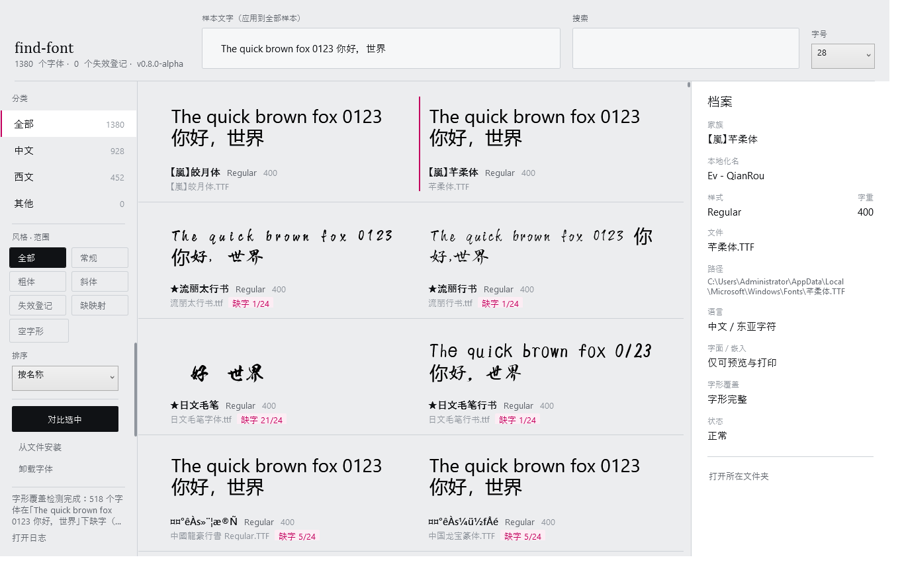

# find-font

**把本机装的所有字体，一次看全。**

Windows 自带的字体查看器只会列文件名。想知道「这个字体排版出来长什么样」「这台机器到底装了多少中文字体」「注册表里那条指向已删除文件的僵尸登记怎么清掉」，它都帮不上忙。find-font 把系统里每个字体按真实字形渲染成样本，让你像翻样本册一样浏览、搜索、对比、安装与卸载。

[](https://github.com/DHA404/find-font/actions/workflows/build.yml)
[](https://github.com/DHA404/find-font/releases)
[](LICENSE)
[](#-环境要求)



## 目录

- [为什么做这个](#为什么做这个)
- [功能](#功能)
- [快速开始](#快速开始)
- [使用](#使用)
- [界面](#界面)
- [核心设计约束](#核心设计约束)
- [架构](#架构)
- [构建](#构建)
- [项目结构](#项目结构)
- [测试](#测试)
- [启动与首屏](#启动与首屏)
- [性能基线](#性能基线)
- [版本与发布](#版本与发布)
- [已知限制](#已知限制)
- [贡献](#贡献)
- [许可](#许可)

## 为什么做这个

三个具体痛点：

1. **看不见字形。** 字体名是「方正准圆简体」，但它到底圆到什么程度、中英文混排时基线对不对，只有渲染出来才知道。
2. **分不清语言归属。** 系统里同时装着西文、中文、日文、韩文上百套字体，靠名字猜和靠眼睛翻是两回事。
3. **有僵尸登记。** 卸载软件时常留下「注册表说有这个字体、文件却已不存在」的条目，普通界面里看不见，也不容易删。

find-font 对这三件事的处理分别是：全部字体离屏渲染成位图、按名字关键词推断语言并计数、把失效登记单独标出来并支持一键清理（只删注册表项，不动任何字体文件）。

## 功能

| 功能 | 说明 |
| --- | --- |
| **全字体预览** | 本机 1300+ 个字体逐个按真实字形渲染，中英文混排，滚动即见 |
| **实时搜索** | 300 ms 防抖，匹配显示名 / 本地化名 / 中文名 / 家族名 / 文件名 / 样式名，任意大小写 |
| **分类与风格筛选** | 全部 / 中文 / 西文 / 其他，全部 / 常规 / 粗体 / 斜体，计数随筛选实时刷新 |
| **四种排序** | 按名称 / 按最近修改 / 按文件大小 / 按语言，排序方式进设置，下次打开照旧 |
| **命中高亮** | 搜索结果的元数据行下方单独一行，命中片段用品格红加下划线标出，一眼看出为什么它被搜出来 |
| **多字体对比** | 按住 Ctrl 选 1–3 个字体同屏对照，改对比文字立刻重渲染 |
| **自定义样本文字** | 顶部输入框改一次，整个列表与对比窗口同步 |
| **安装 / 卸载** | 主程序保持普通权限，仅文件与注册表操作走 UAC 提权微进程；**卸载时只删本工具装过的文件**（进回收站），系统自带字体只清登记 |
| **拖放安装** | 把字体文件拖到窗口任意位置即可安装；拖拽悬停时就按「有没有能装的格式」切换光标，装不了的文件会说明原因 |
| **多字面容器** | `.ttc/.otc` 里每个字面各占一行，标「第 2/3 面」，`simsun.ttc` 的宋体与新宋体都能单独预览 |
| **字形缺失检测** | 拿当前样本文字去每个字体里逐个码位核对，分「cmap 里没有这个字」与「有映射但字形是空的」两类报出来，并列出缺了哪几个字 |
| **拒装网页字体** | `.woff/.woff2/.eot` 是浏览器格式，装进系统目录也看不见，直接明说拒绝原因而不是假装成功 |
| **失效登记清理** | 删除注册表里指向缺失文件的条目，**不删除任何字体文件** |
| **单实例** | 重复双击不会开出第二个窗口，而是把已有窗口叫到前台 |
| **记忆上次状态** | 窗口位置 / 大小 / 上次搜索词 / 样本文字 / 字号 / 分类 / 风格都记在 `%LOCALAPPDATA%\find-font\settings.json` |
| **高分屏清晰** | 声明 PerMonitorV2 DPI 感知，位图按屏幕真实 DPI 渲染（100% / 150% / 200% 物理尺寸一致） |
| **出问题有据可查** | 未处理异常自动落盘到 `%LOCALAPPDATA%\find-font\logs`，保留 7 天；「关于」里一键复制环境信息 |
| **键盘优先** | `Ctrl+F` 搜索、`Esc` 逐层退出、`Enter` 直接对比 |

## 快速开始

### 环境要求

- Windows 10 1803 及以上，或 Windows 11
- [.NET 8 桌面运行时](https://dotnet.microsoft.com/download/dotnet/8.0)（Desktop Runtime）

### 安装

到 [Releases](../../releases) 下载 `find-font-<version>-win-x64.zip`，解压到任意目录，双击 **`FindFont.exe`**。绿色版，不写系统目录、不需要安装程序。

压缩包里只有两个文件：

| 文件 | 说明 |
| --- | --- |
| `FindFont.exe` | 入口引导器（.NET Framework 4.8，约 7 KB），先检测桌面运行时再启动主程序 |
| `FindFont.App.exe` | 主程序，框架依赖单文件（约 400 KB） |

没装 .NET 8 时双击不会毫无反应——引导器会弹框说明缺什么、并给出下载链接。

## 使用

| 操作 | 怎么做 |
| --- | --- |
| 搜索 | 顶部「搜索」框直接输入，或按 `Ctrl+F` |
| 筛选 | 左栏点分类行；风格是四个互斥方块；「只看失效登记」收窄到僵尸条目 |
| 看细节 | 单击任意一行，该行展开成大样本，右侧「档案」列出家族、本地化名、样式、字重、文件、路径、语言、状态 |
| 对比 | 按住 `Ctrl` 选 1–3 个字体后点「对比选中」，或直接双击某一行 |
| 改样本 | 顶部「样本文字」框，全局生效 |
| 换字号 | 右上角字号下拉（20–88） |
| 安装 | 「从文件安装」选 `.ttf/.otf/.ttc/.otc`，会弹 UAC；取消 UAC 视为放弃，不留半成品。选到 `.woff/.woff2/.eot` 会被直接拒绝并说明原因 |
| 卸载 | 选中后点「卸载字体」，同样走 UAC。本工具装过的文件进回收站；系统自带字体**只清除登记、不删除文件**，确认框会写清是哪一种 |
| 清理 | 「清理失效登记」只删注册表项 |
| 退出搜索 | `Esc` 清空搜索词，再按一次取消选中 |
| 对比窗口 | `Enter`，或双击列表行 |

## 界面

默认 1360×880（最小 1080×700），三栏：索引栏 208px、样本瓦片网格、选中时出现的「档案」面板 300px。

字体列表是**多列瓦片网格**而不是单列长条：瓦片宽由列表实际可用宽度算出并向下量化到 32px 桶，列数 1–3 随宽度收敛（右栏展开时列表变窄，会主动退回两列而不是把第三列挤出血）。窗口缩放到 1080 宽时仍是两列，700 宽以下退成一列。列宽量化是因为每变一次尺寸就要重新渲染可见区，量化后拖动窗口只会落进有限几档。

视觉上只有一套灰阶 + 一个强调色：纸灰底 `#ECEDEF`、面板 `#F6F7F8`、墨色 `#101215`、发丝线 `#CDD1D6`，以及唯一用来表达「被选中 / 有焦点 / 已失效」的品红 `#C4005E`。界面字体是 Cambria（标题、样本元数据）与 Segoe UI（控件），全部无圆角，靠 1px 线分层而不是靠卡片阴影。

瓦片样本区固定 96px 高、字形垂直居中，选中不做高度动画（多列网格里行长高会连带整行重排），只把底色抬到 `#FFFFFF` 并在左侧点亮一条 2px 品红竖条——选中状态在一个 340px 宽的瓦片里足够醒目，不值得为它牺牲滚动稳定性。筛选结果逐行错开入场（每行延迟 12 ms、封顶 180 ms），输入框聚焦时底边从中心长出一条 2px 品红标尺。

窗口材质走 `DWMWA_SYSTEMBACKDROP_TYPE`（Win11 22H2+），旧的 `DWMWA_MICA_EFFECT` 与 Win10 的 `SetWindowCompositionAttribute` 逐级回退，全部失败时留在不透明纸色上；材质生效时内容层铺 `#F0ECEDEF` 半透明纸色，保证正文对比度不随壁纸变化。所有动画都读 `SystemParameters.ClientAreaAnimation`——系统关掉动画即全部退化为瞬时切换。

样本文字只用离屏渲染出的位图，XAML 里不会出现 `FontFamily` 绑定（见下节），因此界面字体与字体列表渲染互不影响。

## 核心设计约束

这些约束来自一次踩坑记录，每条都对应一个真实的崩溃、卡顿或内存事故。

| 问题 | 方案 | 代码位置 |
| --- | --- | --- |
| 绑定 `FontFamily` 会让 WPF 加载并常驻上千套字形，内存暴涨 | XAML 里**禁止**出现 `FontFamily` 绑定；改用 `FormattedText` + `RenderTargetBitmap` 在独立 STA 线程离屏出图，缓存为冻结的 `BitmapSource` | `Services/FontRenderCache.cs`、`Converters/FontToImageConverter.cs` |
| 上千个字体逐一解析会卡住界面 | 先同步读注册表立即出列表，再后台异步补全本地化名；补名直读 sfnt 表，约 0.44 ms/文件 | `Services/FontScanner.cs`、`Helpers/FontMetadataReader.cs` |
| 滚动时反复渲染导致掉帧 | `VirtualizingStackPanel` + `VirtualizationMode=Recycling` + `CacheLength=2,1`；瓦片样本按 96 MB 字节预算做 LRU 淘汰，大样本只在对比窗口里按需请求 | `Views/MainWindow.xaml`、`Themes/Templates.xaml` |
| 多列网格里每张瓦片都按自己的宽度渲染，拖窗口会产生无数种尺寸 | 瓦片宽度量化到 32px 桶，列数按列表实际可用宽度收敛到 1–3 列，尺寸变化只在跨桶时发生一次 | `ViewModels/MainViewModel.Layout.cs` |
| 把「同一字体有更新请求」的旧渲染直接取消，会让被取消的那张图永远回不到界面 | 只尊重调用方显式传入的取消令牌，不再按请求序号丢弃；重复渲染交给在途去重与位图缓存 | `Services/FontRenderCache.cs` |
| 输入每个字符都过滤一次会卡顿 | 300 ms 防抖 + 单遍扫描同时产出结果与四个分类计数（`ReplaceAll` 只发一次 Reset）+ 预拼小写 `SearchHaystack` | `ViewModels/MainViewModel.cs` |
| 安装/卸载需要管理员权限，但主程序不该整体提权 | 主进程普通权限，`Verb=runas` 拉起同一个 exe 的微进程只做文件与注册表操作 | `Services/ElevationHost.cs` |
| 注册表指向不存在文件的条目会让扫描崩溃 | 缺失文件生成占位项（品红标记、可一键清理），解析失败静默捕获 | `Services/FontScanner.cs` |
| 卸载若直接删文件会误删系统自带字体 | 维护一份「本工具装过什么」的台账（`%ProgramData%\find-font\installed.txt`），台账里没有的文件一律只清登记；删除走回收站，回收站不可用就报错而不是硬删 | `Services/FontInstaller.cs` |
| 用户没装 .NET 8 时双击 exe 毫无反应 | 入口是 .NET Framework 4.8 引导器（Win10 1803+ 自带），缺运行时弹框给链接 | `src/FindFont.Launcher/Program.cs` |
| 动效写在 XAML 里，用户关了系统动画却还在播 | 全部时长从 `Helpers/Motion.cs` 取，读 `SystemParameters.ClientAreaAnimation`，关闭时返回 `TimeSpan.Zero` | `Helpers/Motion.cs` |
| 重复双击会开出两个窗口、各自扫一遍注册表 | 全局命名互斥体 + `EnumWindows` 找已有窗口叫到前台；拿不到互斥体时降级为允许启动，绝不让程序打不开 | `Helpers/SingleInstance.cs` |
| 窗口大小、搜索词每次重启都丢 | `System.Text.Json` 存 `%LOCALAPPDATA%\find-font\settings.json`，变更后 500 ms 合并写；先写 `.tmp` 再原子替换，避免断电留半截 JSON | `Services/AppSettings.cs` |
| 高分屏上样本偏小发虚 | `app.manifest` 声明 PerMonitorV2；位图按 `VisualTreeHelper.GetDpi` 的真实 DPI 渲染，**DPI 进缓存键**，跨屏拖动不会命中旧 DPI 的模糊图 | `app.manifest`、`Services/RenderDpi.cs` |
| 崩溃后用户什么都说不清 | 未处理异常统一落盘到 `%LOCALAPPDATA%\find-font\logs`（不可写则依次退到 `%TEMP%`），保留 7 天；「关于」一键复制环境信息 | `Helpers/Diagnostics.cs` |
| 「字体里有几个字是空的」和「字体里没这个字」在界面上看起来一样，都是空白 | 分开报：`cmap` 查不到码位记「无映射」，查到了但 `loca/glyf` 的轮廓长度为 0 记「空字形」；CFF 轮廓没有 `loca`，只报无映射并标注不支持，不猜 | `Helpers/GlyphCoverageReader.cs`、`Models/GlyphCoverage.cs` |

更多取舍（为什么直读 sfnt 而不是 `GlyphTypeface`、为什么用 `Motion.Hold` 而不是 `FillBehavior.Stop`）写在 `.docs/PLAN.md`。

## 架构

```
     ┌────────────────┐  注册表（HKLM/HKCU × 32/64）
     │  FontScanner   │──────────────┐
     └────────────────┘              │ 同步：立即出列表
              │ 异步                    ▼
              │                 ┌──────────────────┐
     ┌────────▼────────┐        │  MainViewModel   │
     │ FontMetadata-   │        │  搜索/筛选/多选   │
     │ Reader（sfnt）  │───────▶│  分类计数/档案    │
     └─────────────────┘  补名   └────────┬─────────┘
                                          │ 请求位图
                                  ┌───────▼─────────┐
                                  │ FontRenderCache │
                                  │  STA 渲染线程    │
                                  │  LRU + 字节预算  │
                                  └───────┬─────────┘
                                          │ 冻结 BitmapSource
                                  ┌───────▼─────────┐
                                  │  Image（XAML）   │
                                  └─────────────────┘
```

技术栈：C# 12 / .NET 8 / WPF / MVVM（`CommunityToolkit.Mvvm`）/ 无第三方 UI 库。

写入路径（安装、卸载、清理）不走上述链路，而是 `FontInstaller` → `ElevationHost` → `runas` 起同一个 exe 带 `--install-font` 之类参数运行 → 主程序在 `App.OnStartup` 里识别到操作请求就执行并立即退出。这样提权面被压缩到一个只做文件与注册表操作的分支。

## 构建

> 本机 `%TEMP%\MSBuildTemp`、`%USERPROFILE%\.templateengine`、NuGet v3-cache 均不可写，`build.cmd` 会把 `TMP`/`TEMP`/`NUGET_PACKAGES`/`DOTNET_CLI_HOME` 全部重定向到仓库内的 `.build`、`.nuget` 目录。

```bat
build.cmd          :: 编译
build.cmd test     :: 跑冒烟测试（扫描真实系统字体并实际渲染位图）
build.cmd run      :: 直接启动
build.cmd publish  :: 发布到 publish\ 并打包 dist\find-font-<version>-win-x64.zip
```

手动构建等价于：

```bat
set TMP=%~dp0.build\tmp
set NUGET_PACKAGES=%~dp0.nuget\packages
set DOTNET_CLI_HOME=%~dp0.build\home
dotnet build FindFont.slnx -c Debug
```

`build.cmd` 本身必须是纯 ASCII：`cmd.exe` 用 OEM 代码页解析批处理，UTF-8 中文注释会被拆成乱码命令，进而让 `%TEMP%` 重定向失效。

## 项目结构

```
assets/find-font.ico             应用图标（16–256 七档，两个 exe 共用）
src/FindFont.Launcher/           .NET Framework 4.8 引导器（运行时检测 + 启动 FindFont.App.exe）
src/FindFont.App/
  app.manifest                     PerMonitorV2 DPI 感知、longPathAware、最高支持的 OS
  Models/FontItem.cs               字体条目（BestName 回退链、SearchHaystack、小/大样本两个位图槽）
  Models/FacetItem.cs              左栏分类索引行（名称固定、计数就地更新）
  Collections/RangeObservableCollection.cs   整批替换只发一次 Reset
  Helpers/NativeMethods.cs         AddFontResourceEx / RemoveFontResourceEx / WM_FONTCHANGE 广播
  Helpers/FontMetadataReader.cs   字体元数据入口（sfnt 优先，GlyphTypeface 回退）
  Helpers/FontMetadataReader.Reading.cs  一次打开读完整个文件的全部字面
  Helpers/SfntReader.cs           sfnt/ttcf 容器、表目录、big-endian tag
  Helpers/NameTableParser.cs      name 表记录与本地化名评分
  Helpers/LanguageInference.cs    按名字关键词推断 CJK 归属，不解析字符表
  Helpers/CmapReader.cs           cmap 子表选择与 fmt 0/4/6/12 查表
  Helpers/GlyphCoverageReader.cs  逐码位核对：cmap 有无映射 + glyf 轮廓是否为空
  Models/GlyphCoverage.cs         缺字结论（四类 + 缺失字符清单）
  Helpers/Motion.cs               三档时长 + 遵循系统动画开关
  Helpers/WindowBackdrop.cs       Mica / Acrylic / 降级，三级回退
  Helpers/SingleInstance.cs       命名互斥体 + 唤起已有窗口
  Helpers/Diagnostics.cs          崩溃日志（可写目录回退链、保留 7 天）
  Helpers/StartupTrace.cs         启动打点：从进程启动到首屏各阶段毫秒数
  Services/FontScanner.cs         扫描流水线编排：注册表 → 文件探测 → 构建条目
  Services/FontRegistryReader.cs  并行读 HKLM/HKCU × 32/64 四种视图，输出顺序固定
  Services/FontFileIndex.cs       按文件并行探测（一次打开拿全部字面 + 大小 + 时间）
  Services/FontItemBuilder.cs     探测结果 → FontItem，含坏字体与旧式 .fon 的分流
  Services/FontDeduplicator.cs    同文件同家族的合并规则
  Services/FontRenderCache.cs     字节预算 LRU + 并发去重 + 过期请求丢弃 + 线程池调度
  Services/FontRenderCache.Pool.cs        2–4 条 STA 渲染线程，按缓存键哈希分派
  Services/FontRenderCache.Rendering.cs   FormattedText / RenderTargetBitmap / 每线程 Typeface 缓存
  Services/FontInstaller.cs       安装 / 卸载 / 清理失效登记（仅提权进程执行）
  Services/FontInstaller.Registry.cs     注册表值名与读写
  Services/ElevationHost.cs       --install-font 等参数协议的微进程宿主
  Services/AppSettings.cs         settings.json 读写、窗口几何、屏幕可见性校验
  Services/RenderDpi.cs           当前监视器 DPI 的来源
  Services/FontCoverageIndex.cs   字形覆盖探测：并行 + 按（路径、字面、探测集）缓存
  Converters/                     FontToImage（MultiBinding → BitmapSource）、可见性转换器
  Themes/Tokens.xaml              色板、字体、尺寸常量（唯一配色来源）
  Themes/Controls.xaml            聚合器：Inputs / Buttons / Rows 三份
  Themes/Templates.xaml           样本行模板（行高动画 + 双图交叉淡化）
  Themes/Scrollbars.xaml          4px 细滚动条
  ViewModels/MainViewModel.cs     状态字段、集合、计算属性
  ViewModels/MainViewModel.Filtering.cs   扫描加载、防抖搜索、筛选、分类计数
  ViewModels/MainViewModel.Preview.cs     首屏预热与预览位图生命周期
  ViewModels/MainViewModel.Layout.cs      多列分行、瓦片宽度、瓦片选中
  ViewModels/MainViewModel.Coverage.cs    缺字检测的防抖、批量量测与结果回填
  ViewModels/MainViewModel.Commands.cs    选择、安装、卸载、清理、打开目录
  ViewModels/MainViewModel.Settings.cs    设置往返、DPI 刷新、关于/日志命令
  ViewModels/CompareViewModel.cs  最多三款字体同屏对照
  Models/FontRow.cs               一行瓦片的数据载体
  Models/FontItem.Tile.cs         瓦片选中标记与请求入口
  Views/MainWindow.xaml(.cs)      主窗口
  Views/MainWindow.Tiles.cs       瓦片点击、列宽刷新、全选
  Views/CompareWindow.xaml(.cs)   对比窗口
  Views/AboutWindow.xaml(.cs)     关于：环境信息一键复制
tests/FindFont.SmokeTests/        无第三方依赖的控制台冒烟测试（TestRunner + Tests/ 分层）
```

## 测试

```bat
build.cmd test
```

测试直接跑真实字体库，不 mock：扫描本机注册表、遍历全部字体文件、实际渲染位图。失败时返回非零退出码，CI 据此拦截。

1. `LanguageInference` 关键词推断（中 / 日 / 韩 / 西文 / 空名）
2. `FontMetadataReader.ContainsCjk` 的 CJK 判定与 null 安全
3. `FontItem.BestName` 三级回退与 `DedupKey` 大小写不敏感
4. 真实扫描本机注册表（断言字体数 > 0、字段非空）
5. `EnhanceAsync` 抽样补全，断言字重被回填；旧式 `.fon` 不得误判为异常
6. sfnt 直读覆盖率 100%（不退回 `GlyphTypeface` 慢路径），抽样核对 SimSun / Arial / 微软雅黑的家族名与中文名
7. `FontRenderCache` 实际出图，断言尺寸 > 0、已 `Freeze`、二次请求命中缓存
8. `MainViewModel` 真实加载后验证搜索、分类筛选、风格筛选与清空恢复
9. 1 万条字体的压测：装载、搜索、筛选、清空恢复各自的耗时上限
10. `CompareViewModel` 最多三栏上限与移除后栏数变化
11. 界面资源与主窗口可构造，分类索引行计数与选中分类下的可见项数一致，画布不小于 1300×860
12. 动效助手遵循系统设置：`Motion.Evaluate(true/false)` 返回值与三档时长排序
13. 窗口材质回退不抛异常：`WindowBackdrop.Apply` 在任意系统版本上都返回合法档位
14. 尺寸与模板资源：默认画布、最小时宽、模板键存在性
15. 版本号来自 `version.txt`：程序集元数据、`AppInfo.DisplayVersion`、视图模型三处一致
16. 位图缓存受字节预算约束：塞入超预算的大图后总量回落到预算内
17. 同键并发请求只渲染一次：10 个并发请求共用同一张图
18. 未选中的行不渲染大图：构造样本行不触发 220px 渲染，选中后才出现
19. `RangeObservableCollection` 只发一次 Reset
20. 搜索快路径与原多字段匹配等价：200 个真实字体 × 6 组查询串逐一比对
21. 卸载不删系统字体文件：未经本工具安装的文件一律不算托管，只清登记
22. 网页字体（WOFF）明确拒装：`.woff/.woff2/.eot` 在碰系统目录之前就被拒绝，且文件未被复制
23. 字体注册表值名格式正确：`.ttc` 用「(TrueType collection)」、`.otf` 用「(OpenType)」，后缀不重复
24. 单实例互斥体只放行一个进程：第二次 `Acquire` 必须识别出已有实例
25. 设置的默认值与屏幕可见性判断（拔掉显示器后窗口坐标不会被恢复）
26. 设置经视图模型往返一致：预览文字 / 字号 / 分类 / 风格 / 搜索词
27. 渲染 DPI 只在合理范围生效：0 / 负数 / NaN / Infinity 一律回落到 96
28. DPI 参与位图缓存键：同一字体换 DPI 必须拿到另一张图
29. 崩溃日志落盘且带上下文，且不抛异常
30. 源文件不超过 300 行（与 CI 里的同名检查互为双保险）
31. 多字面容器展开为多条字体：`simsun.ttc` 解出 2 个字面，同容器内 FaceIndex 不重复
32. 字符覆盖优先于名字推断语言：OS/2 `ulUnicodeRange` 的汉字位判中文，日文假名与汉字同时出现的字体不误判
33. 嵌入权限位翻译成文案：`fsType` 各标志位对上中文说明
34. 四种排序键正确且稳定：每个模式按自己的键排序，键相同时按名称兜底（结果可复现）
35. 搜索高亮切分命中片段：命中保留原大小写，前缀/后缀边界正确，空白查询清空
36. 拖放安装复用同一分拣路径：空列表安全返回，网页字体在碰系统目录前被拒
37. 多字面标注与渲染键：单字面无标注，多字面渲染键带 `#<faceIndex>`
38. 批量读字面与逐字面读取等价：一次打开读出的每个字面，家族名与序号都与单独读取一致
39. 每个字体文件只探测一次：索引结果条数等于去重后的文件数
40. 注册表并行读取顺序稳定：两次并行读取的条目顺序逐项一致
41. 首屏预热覆盖可见行：预热投递不阻塞 UI（断言 <200 ms），之后位图陆续落位
42. 渲染线程池并行出图：线程数夹在 2–4，不同键能同时出图且每个键只渲染一次
43. cmap 无映射被识别：`流丽行书.ttf` 里「你」不在 cmap 中，判为无映射；同串「世」完整
44. 映射到空字形被识别：`日文毛笔字体.ttf` 里「你」有映射但 `glyf` 轮廓为 0，判为空字形
45. 两类缺字不会混淆：Arial 面对汉字全是无映射，不会误报空字形
46. 多字面字形覆盖独立检测：`simsun.ttc` 的两个字面各自量测，覆盖集合都在
47. CFF 字面不判空字形：只认「有 `CFF ` 表且没有 `loca`」的真 CFF 字体，断言其不宣称支持
48. 字形覆盖检测复用缓存：同一探测集第二次不再读盘，结果可从缓存取回
49. 缺字筛选只留对应类型：「只看缺映射」「只看空字形」各自只留对应项，两个都开是交集（未检测项不算通过）
50. 多列分行与筛选顺序一致：37 条按 2/3/1 列切出的行数与末行瓦片数正确，展平后顺序与源集合逐项相同
51. 列数随窗口宽度收敛：1360/1120 → 3 列，1080/852 → 2 列，700/470 → 1 列；瓦片宽度始终 ≥220 且是 32 的整数倍；宽度微调不改变结果
52. 瓦片选中驱动既有筛选语义：独占、Ctrl 切换、Shift 连选、清空都落到同一个选中集合上

当前全部通过（52 项）。

## 启动与首屏

打开软件到看见第一屏字体缩略图，这条链路被拆成可以分别量测的五段。全部打点由 `Helpers/StartupTrace.cs` 记录，「关于 / 环境信息」窗口底部会列出这一次启动的每一段耗时，日志里也写一份。

| 阶段 | 做什么 | 关键取舍 |
| --- | --- | --- |
| 引导器 | 检查 .NET 8 桌面运行时再拉起主程序 | 检测结果缓存在 `%LOCALAPPDATA%\find-font\runtime-check.txt`，`dotnet --list-runtimes` 不再每次都拉起一个主机进程 |
| 主程序启动 | 单实例互斥体、窗口构造、DWM 材质 | DPI 在窗口构造后立刻上报，早于任何渲染请求，避免首屏按 96 DPI 出图再被拉伸 |
| 扫描 | 读四个注册表视图 → 探测文件 → 建条目 | 注册表并行读、每个路径只 `ResolvePath` 一次、每个文件只打开一次（字面/大小/修改时间一次拿全） |
| 后台补名 | 给名字解析失败的条目补本地化名 | 只在必要时跑，每 50 条批量回填；扫描一结束主界面就可交互，不等补名 |
| 首屏出图 | 预热视口内的十几行小样本 | 请求一次性全投给 2–4 条渲染线程，UI 不等图；串行要 1.1 s，并发冷启动约 150 ms |

这不只是「快一点」的问题：早期版本在 UI 线程上逐张等位图，首屏 12 行要 1.1 秒，用户看到的是十二行「正在渲染…」同时定格。现在画面在第一帧就位图齐备。

## 性能基线

本机（Windows 11 26H2、1380 个已装字体、1329 个不同字体文件，其中 23 个多字面容器展开出 70 个字体）实测：

| 场景 | 耗时 |
| --- | --- |
| 注册表扫描出完整列表（含字面展开、语言判定、文件时间） | 约 0.4 s（优化前 1.2 s） |
| 全量元数据解析（每文件只打开一次） | 约 270 ms（0.20 ms/文件，优化前 453 ms） |
| 首屏 12 行出图（冷启动，4 条渲染线程并发） | 约 150 ms（串行要 1.1 s） |
| 单个样本行再渲染（缓存命中） | < 0.01 ms |
| 1 万条字体的搜索 / 筛选 / 清空恢复 | 各约 1 ms |
| 字形覆盖检测（1380 个字体，24 个不同码位） | 约 140 ms，再次检测命中缓存约 1 ms |
| 内存占用（1380 个字体、可视区渲染完） | 约 160 MB，位图缓存上限 96 MB |

上面的数字来自仓库外的进程内基准（扫描 / 元数据 / 首屏三段各自计时）。测试里刻意不断言绝对毫秒——CI 机器的磁盘比开发机慢一个数量级，绝对时间断言必然假失败；性能护栏改成断言结构性保证（只打开一次、只探测一次、并发数在合理区间、预热不阻塞 UI）。

滚动性能的关键是「只有被选中的行才渲染大样本」：早期版本里每个行模板都在实例化时对 `LargeSample` 求值，滚过一行就多渲染一张 1500×220 的大图。现在大样本改由视图模型的 `RequestLargePreviews` 按选中集合主动请求，行模板只绑 `PreviewBitmapLarge` 属性。

## 版本与发布

版本号只写在仓库根的 `version.txt` 一处。`Directory.Build.props` 把它读成 `Version`，所以程序集元数据、窗口标题行、`dist/find-font-<version>-win-x64.zip` 的命名、CI 的打包与校验全都来自同一个值。

发一个新版本是三步：

```bash
echo 0.5.0-alpha > version.txt                        # 1. 改版本号
git commit -am "release: 0.5.0-alpha"                 # 2. 提交
git tag v0.5.0-alpha && git push origin main --tags   # 3. 打新 tag
```

tag 触发时 CI 会先校验 `v$(cat version.txt)` 与 tag 名完全一致，不一致直接失败，避免「新 tag 顶着旧版本号发出去」。每个版本用独立的新 tag——不要删掉旧 tag 再重建：复用同一个 tag 会让 Release 页面一直显示同一个版本号，也让「这次究竟改了什么」无法追溯。

## 已知限制

- 旧式 `.fon` 位图字体不是 sfnt 容器，无法读取家族名，列表里以文件名做显示名（不标记为异常）。
- 多字面容器按文件头声明的成员逐个展开；嵌在 `.ttc` 里、但文件头没有独立声明的隐藏字面仍取不到。
- 语言归属优先用 OS/2 `ulUnicodeRange` 的字符覆盖位；个别字体没写这张表，才回落到名字关键词推断，此时冷门字体可能落进「其他」。
- 注册表扫描只覆盖 `HKLM`/`HKCU` 的 `Windows NT\CurrentVersion\Fonts`，不处理通过 GDI 私有加载的临时字体。
- 主程序是框架依赖单文件，依赖目标机已装 .NET 8 桌面运行时；缺失时由引导器提示并给出下载链接。
- 首次启动（ReadyToRun 缓存未预热、系统文件缓存为空）比后续启动慢；第二次起明显更快。
- 字形缺失检测只认 `glyf` 轮廓（真 CFF/PostScript 轮廓的 `.otf` 没有 `loca` 表），这类字体只报「无映射」，不判断字形是否为空。
- 缺字检测的依据是「当前样本文字」这一小组码位，不是整张字符表；它回答的是「我这串字能不能显示出来」，不是「这个字体完整吗」。

## 贡献

欢迎提 Issue 与 PR。提交前请确认：

1. `build.cmd test` 全绿（测试跑的是真实系统字体，本机数字与 CI 会不同，断言只看覆盖率与等价性，不看绝对耗时）。
2. XAML 里没有新增 `FontFamily` 绑定——这是这套架构的地基。
3. 长耗时操作是异步的，`ObservableCollection` 只在 UI 线程改。
4. 单个文件尽量控制在 300 行内，视图逻辑放视图模型。

## 许可

[MIT](LICENSE) © 2026 DHA404
